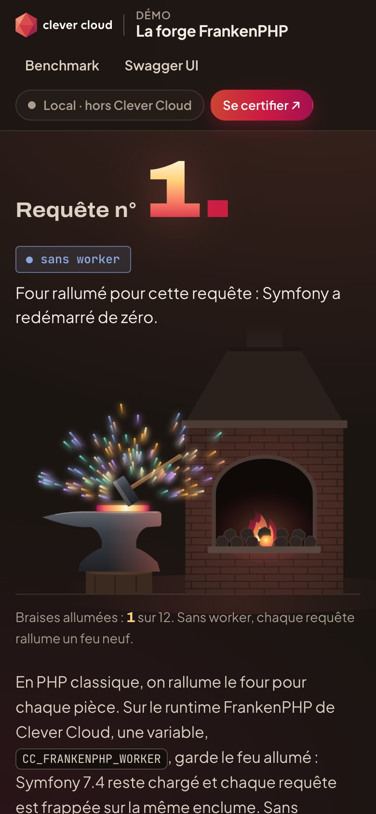

# The Ever-Lit Forge — Symfony in FrankenPHP worker mode on Clever Cloud

> In classic PHP, the furnace is relit for every piece; in worker mode, the fire never goes out. A Symfony 7.4 app on the **FrankenPHP runtime** of Clever Cloud, without a Dockerfile, in **worker mode**: one variable, `CC_FRANKENPHP_WORKER`, keeps the Symfony kernel in memory between requests instead of booting it for each one. The page is a blacksmith's forge drawn in SVG. "Requête n° 214." is stamped in hot metal: the real number of requests the PHP worker answering you has already served. The hearth lights one more coal each time that number doubles. A button fires 40 requests at `/worker`: the hammer strikes, one spark flies per response, and each one lands in a measured spark chart (server time, worker, Symfony restarts). Below: the Clever Cloud Academy hallmark, k6 measurements of the same page served three ways, drawn as iron bars, and a read-only API Platform API on SQLite whose monsters hang on the smith's display rack. No add-on.




**Run it yourself.** The hosted demo was taken down after the presales review (November 2026). The steps in [Deploy on Clever Cloud](#deploy-on-clever-cloud) recreate it from scratch in about 5 minutes.

**Get certified.** This demo runs on Clever Cloud. To deploy your own apps the same way, get certified at the [Clever Cloud Academy](https://academy.clever.cloud/).

## What FrankenPHP worker mode does here

| Where | Feature | What you see |
|---|---|---|
| The stamped number | `CC_FRANKENPHP_WORKER=/public/index.php`: `symfony/runtime` 7.4 detects `FRANKENPHP_WORKER` and serves requests in a loop with its `FrankenPhpWorkerRunner` | "Requête n° N." in hot metal grows on each reload, the `worker 3f9ac1` chip, "Le feu brûle depuis …" |
| The hearth | `src/Demo/WorkerStats.php`: static properties, which survive between requests only in worker mode | 12 coals, one more lit each time the worker doubles its request count (1, 2, 4… 2048), and the flames grow with them. Without the worker: one coal, a small fresh fire |
| "Envoyer 40 requêtes" | 40 calls to `/worker`, four at a time, each returning the state of the worker that served it | The hammer strikes and one spark per response flies off the anvil, in the colour of the worker that served it. The spark chart ("La gerbe") draws one spark per request: height = server time, colour = worker, a dotted budget line, a small flame under the baseline when Symfony booted for that request. Below: median, requests under budget, workers seen, "Fours rallumés" (Symfony restarts, responses with `request === 1`). On the hosted app: median about 1–2 ms, **0 Symfony restarts**, 2 to 4 workers seen |
| "Le feu qui vous répond" plate | Same static properties | Mode, worker id and PID, time in memory, requests served, PHP memory, this page's server time |
| Recycling | `FRANKENPHP_LOOP_MAX` (default 500, `0` = never) | "Four rallumé dans N requêtes"; with `FRANKENPHP_LOOP_MAX=10`, a worker recycles in the middle of a burst (new colour, flames under the baseline, restarts > 0) |
| Without the worker | Remove `CC_FRANKENPHP_WORKER`, then `clever restart` | "sans worker" chip, one coal, 40 different PHP scripts and 40 relit furnaces in the burst |
| Every response | `Server-Timing: app;dur=…` | PHP time since the request arrived, including the Symfony boot outside worker mode |
| "Réglages de la forge" and "Running on Clever Cloud" plates | `src/Demo/DemoSettings.php` | The four demo variables and what each one changes; the variables injected by Clever Cloud ("Local" outside the platform) |
| Benchmark section | k6 reports committed in `benchmark/` | Three iron bars, only the worker one glowing: p95 latency of the home page, 100 virtual users, 3,000 requests, 0 failures, measured locally (`https://localhost`, HTTP/2): FrankenPHP classic 22.44 ms, PHP-FPM 15.97 ms, FrankenPHP worker 6.66 ms. They compare the execution modes, not Clever Cloud |
| The display rack | API Platform resource with `Get` and `GetCollection` only | The 7 monsters hang as forged pieces, each one a link to `/api/monsters/{id}` |

To show it live: reload (the number and the uptime climb, a coal lights up each time the count doubles), fire a burst (sparks fly from the anvil), then change a demo variable and restart; the counter starts again from zero, on new processes: the forge has been relit.

```bash
clever env set ANNOUNCEMENT "Maintenance tonight at 10 pm"
clever env set LATENCY_BUDGET_MS 1          # stricter budget: red bars
clever restart
```

## Deploy on Clever Cloud

You need [clever-tools](https://www.clever.cloud/developers/doc/cli/) (`clever login` done) and the ID of the organisation that will own the resources (`orga_…`, shown in the Console). Run the commands from the repo root: `clever create` links the folder to the new app.

```bash
# 1. The app and its size: data is read-only, so two instances are fine
clever create --type frankenphp demo-php-frankenphp --org <org_id> --region par
clever scale --min-flavor nano --max-flavor XS --min-instances 1 --max-instances 2
clever scale --build-flavor M

# 2. Symfony
clever env set APP_SECRET "$(openssl rand -hex 32)" >/dev/null   # generated here, never printed
clever env set APP_ENV prod
clever env set APP_DEBUG 0

# 3. The FrankenPHP runtime: web root, worker, hooks, health check
clever env set CC_WEBROOT public
clever env set CC_FRANKENPHP_WORKER /public/index.php
clever env set CC_POST_BUILD_HOOK "php bin/console assets:install public --no-interaction && php bin/console cache:warmup"
clever env set CC_PRE_RUN_HOOK "php bin/console doctrine:migrations:migrate --no-interaction --allow-no-migration"
clever env set CC_HEALTH_CHECK_PATH /health
clever env set CC_CACHE_DEPENDENCIES true

# 4. Deploy
clever deploy
clever open
```

No add-on: the data lives in SQLite (`var/data.db`). The pre-run hook replays the Doctrine migrations at every start, which recreate the `monster` table and its 7 rows; the API is read-only, so `clever restart` is the only reset, and each instance has its own identical copy. `vendor/` is not committed: Clever Cloud runs `composer install` at each build.

`.clever.json` is tracked by git and empty in the repo; `clever create` writes the new app's ID into it. Do not commit that linked version.

## Variables

| Variable | Set by | Role |
|---|---|---|
| `APP_SECRET` | you, generated (`openssl rand -hex 32`) | Symfony secret. `.env` only holds a placeholder |
| `APP_ENV` | you | `prod`. Also the environment chip of the process plate (Clever gradient for `prod` or `production`). `production` or an unknown value starts Symfony in `prod` without debug (`src/Kernel.php`) |
| `APP_DEBUG` | you | `0` |
| `CC_WEBROOT` | you | `public`, Symfony's web root. "If you need to serve files from a specific directory, set the CC_WEBROOT environment variable" ([FrankenPHP runtime](https://www.clever.cloud/developers/doc/deploy/applications/frankenphp/)) |
| `CC_FRANKENPHP_WORKER` | you | `/public/index.php`: turns worker mode on. The path is "relative to the root of your project", and "The worker script must be located within the webroot directory" |
| `CC_POST_BUILD_HOOK` | you | `assets:install` (Swagger UI assets) and `cache:warmup`, built once and kept in the build cache: "Ran after the project is built, and before the cache archive is generated" ([reference](https://www.clever.cloud/developers/doc/develop/common-configuration/environment-variables/reference/)) |
| `CC_PRE_RUN_HOOK` | you | `doctrine:migrations:migrate`: recreates the SQLite database at every start. "This hook runs every time" ([hooks](https://www.clever.cloud/developers/doc/develop/common-configuration/build-hooks/)) |
| `CC_HEALTH_CHECK_PATH` | you | `/health`: traffic switches only when the app answers 200. "If these paths don't return a 2xx response code, the deployment fails" |
| `CC_CACHE_DEPENDENCIES` | you | `true`: "Enable caching of your build dependencies to speed up following builds." (default `false`) |
| `ANNOUNCEMENT` | you, optional | Banner at the top of every page (160 characters max, escaped). Empty by default |
| `LATENCY_BUDGET_MS` | you, optional | `10` by default (1 to 10,000): dotted line of the spark chart, hollow red sparks above it, "Sous N ms" counter |
| `BURST_SIZE` | you, optional | `40` by default (5 to 200): number of requests in the burst |
| `FRANKENPHP_LOOP_MAX` | you, optional | Worker recycling, default 500, `0` = never. **A non-integer value makes the Symfony runtime crash at startup** |

An invalid or out-of-range value of `ANNOUNCEMENT`, `LATENCY_BUDGET_MS` or `BURST_SIZE` falls back to the default.

Do not set:
- `CC_PHP_VERSION`: no effect on this runtime, "FrankenPHP uses this version whatever the value of CC_PHP_VERSION" (FrankenPHP 1.13.1 / PHP 8.5.12 on 2026-10-21).
- `CC_PHP_COMPOSER_FLAGS`: the default `-n --no-dev --no-progress --no-scripts` fits; `--optimize-autoloader` comes from `config.optimize-autoloader: true` in `composer.json`. Since `--no-scripts` skips Symfony's auto-scripts, the build hook runs `assets:install` and the cache warm-up.
- `CC_DISABLE_BUILD_CACHE_UPLOAD`: "Don't use it with nano and pico plans".

The "Running on Clever Cloud" plate shows `CC_APP_NAME`, `APP_ID`, `INSTANCE_NUMBER` (with `CC_PRETTY_INSTANCE_NAME`), `INSTANCE_TYPE`, `CC_COMMIT_ID` (short) and `CC_DEPLOYMENT_ID`, and nothing else; `APP_ID` also turns the top pill into "Live on Clever Cloud". Locally the plate reads "Local" and each value "injecté au déploiement".

## Routes

| Route | What it does |
|---|---|
| `GET /` | The forge (stamped number, hearth, spark chart, process plate), settings and Clever Cloud plates, Clever Cloud Academy block, k6 benchmark, API display rack, deployment |
| `GET /worker` | JSON state of the worker that served the request (`mode`, `worker`, `request`, `uptime_s`, `memory_mb`, `server_ms`, `recycle_in`…), `Cache-Control: no-store` |
| `GET /health` | `{"status":"ok"}`, without touching the database |
| `GET /api`, `/api/monsters`, `/api/monsters/{id}` | API Platform 4.4 and its Swagger UI, read-only: any write answers 405 |
| `GET /benchmark/summary-(10\|100)-vus-(fpm\|no-worker\|worker)` | The committed k6 reports |
| `GET /download-logo` | The FrankenPHP logo (`private-files/frankenphp.png`) |

## Code tour

```
public/index.php                    front controller: returns the kernel to symfony/runtime, which loops on it in worker mode
src/Kernel.php                      APP_ENV normalisation (production or unknown → prod, without debug)
src/Demo/WorkerStats.php            the worker's state: id, start time, request count, in static properties
src/Demo/DemoSettings.php           demo variables and Clever Cloud variables, exposed to Twig as `demo`
src/EventSubscriber/WorkerRequestSubscriber.php    counts each main request, adds Server-Timing
src/EventSubscriber/SecurityHeadersSubscriber.php  CSP and security headers
src/Controller/MainController.php   /, /worker, /health, /benchmark/{name}, /download-logo
src/Entity/Monster.php              API Platform resource, Get and GetCollection only
migrations/                         SQLite schema and the 7 monsters
templates/                          home page, Academy block, error page, Swagger UI override
templates/partials/forge.svg.twig   the forge in SVG: 12 coals lit from the worker's real request count
public/demo.js                      the burst: spark chart, hammer, sparks and coals (no inline script: strict CSP)
public/demo.css                     forge styles, re-tints the Brand Kit tokens; public/cc-brand.css is the Clever Brand Kit, not to be edited
benchmark/                          k6 script and the six committed reports
scripts/smoke.sh                    13 route checks: ./scripts/smoke.sh [URL]
php.ini                             expose_php = Off, read by FrankenPHP from the project root
```

PHP 8.5 (FrankenPHP runtime), Symfony 7.4 LTS, API Platform 4.4, Doctrine ORM 3.7 / DBAL 4.5, SQLite, Twig 3.30. `Caddyfile`, `benchmark.Caddyfile` and `static-build.Dockerfile` are not used on Clever Cloud (local worker mode, k6, optional static binary).

## Run locally

```bash
composer install
php bin/console doctrine:migrations:migrate -n
php bin/console assets:install public
APP_ENV=production ANNOUNCEMENT="Test" LATENCY_BUDGET_MS=10 BURST_SIZE=40 php -S 127.0.0.1:8105 -t public
./scripts/smoke.sh                     # 13 route checks
php bin/console lint:twig templates && php bin/console lint:container && composer audit
```

Under `php -S`, **worker mode is not reproduced**: each request is a new script ("Requête n° 1.", "sans worker", a single coal, 40 relit furnaces in the burst), which is also the useful contrast. The screenshots and the animation above were taken on Clever Cloud, in worker mode. For worker mode locally: `frankenphp run` (the committed `Caddyfile`). Under `php -S`, `$_SERVER` does not contain the environment: Symfony keeps `APP_ENV` from `.env`, while the chip reads the real variable.

## Security

- Root `php.ini` with `expose_php = Off` (loaded automatically by FrankenPHP on Clever Cloud): no `X-Powered-By` header.
- Strict CSP (`script-src 'self'`) on demo pages, plus `nosniff`, `Referrer-Policy`, `X-Frame-Options` (`src/EventSubscriber/SecurityHeadersSubscriber.php`); no CSP on `/api` (Swagger UI) and `/benchmark/…` (k6 reports). Page script lives in `public/demo.js`: do not add inline scripts.

MIT License.
